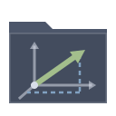
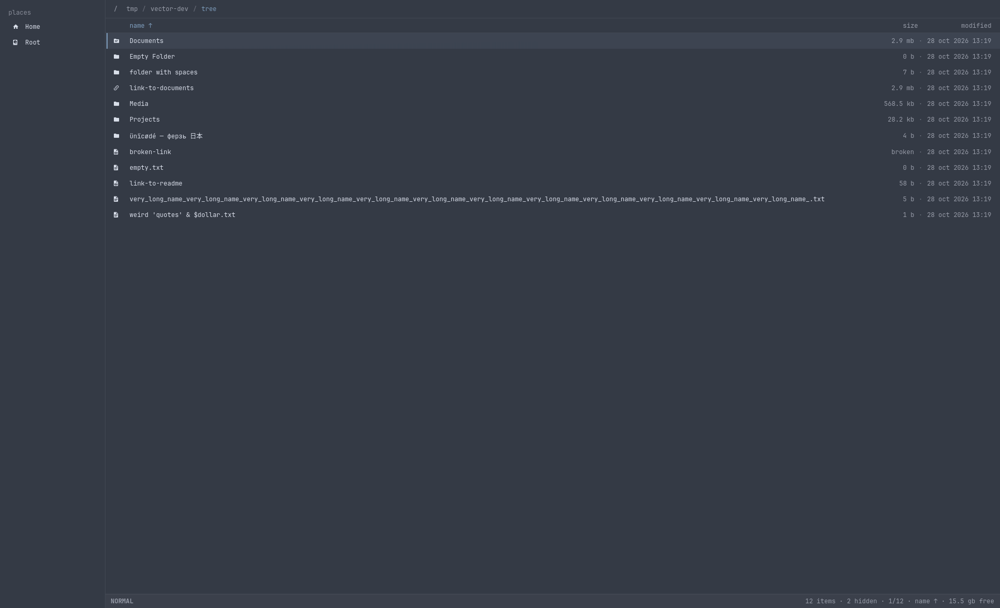
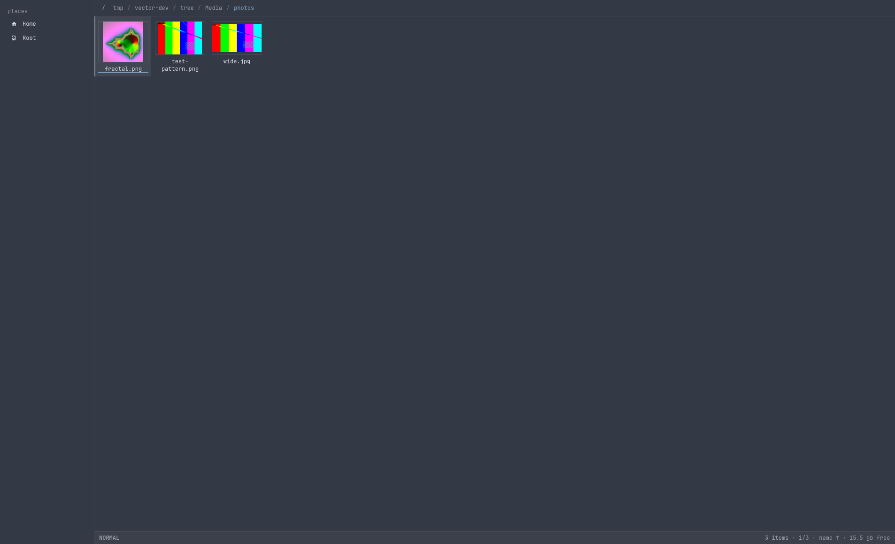
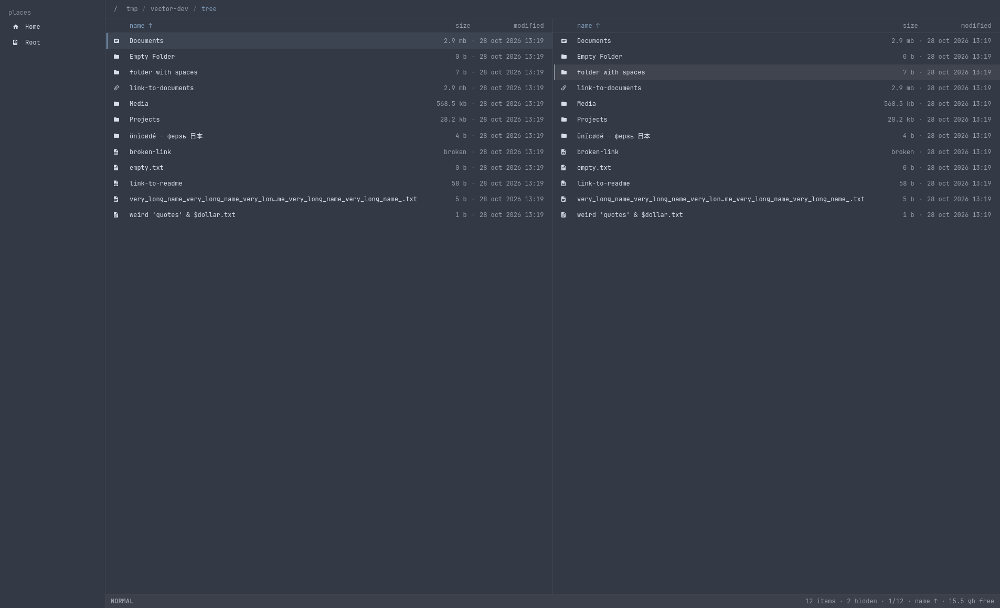
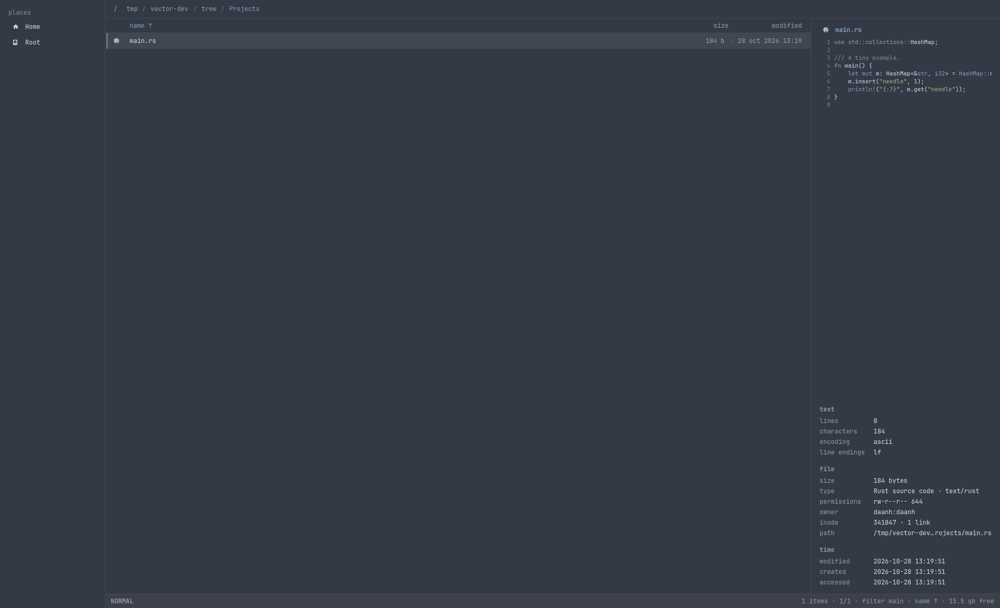
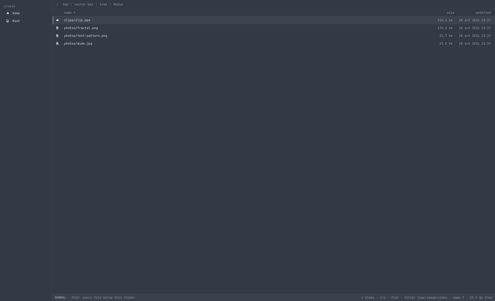
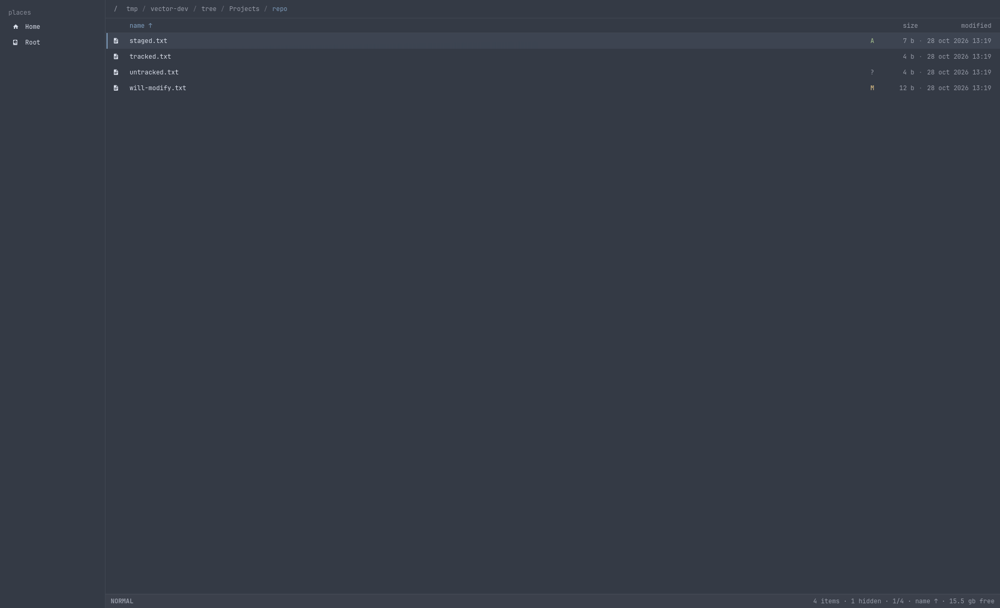
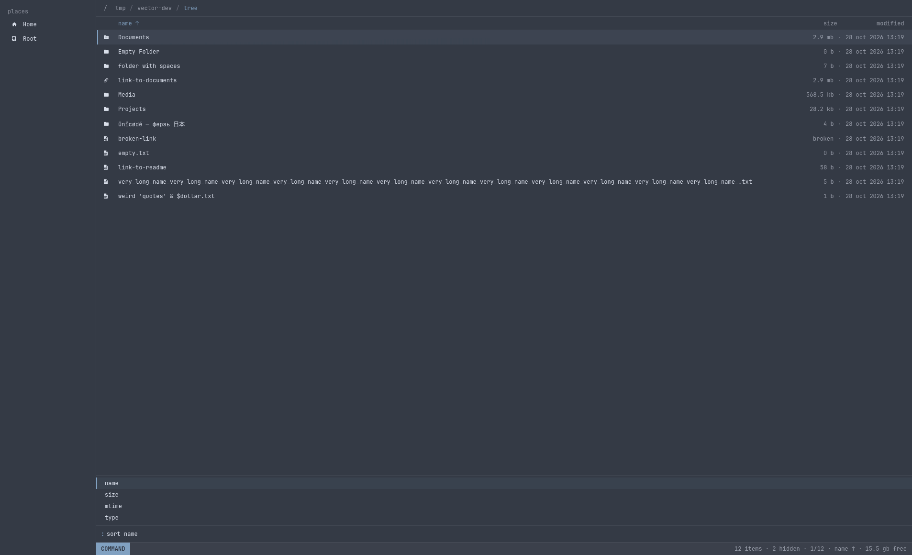
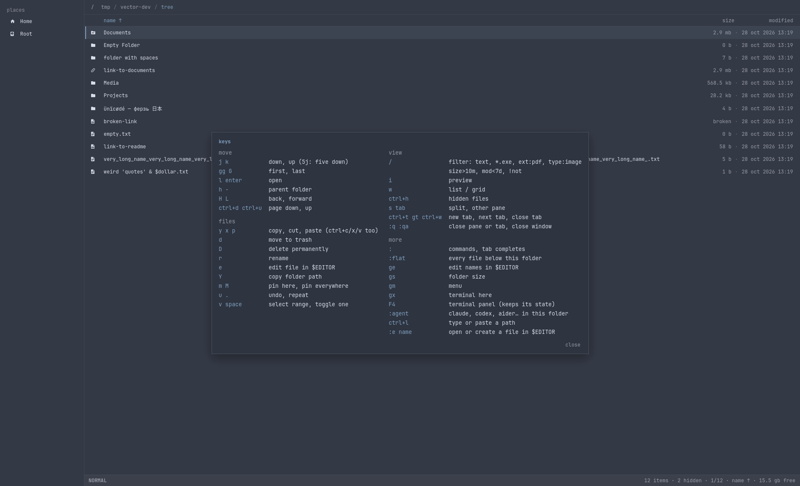

<a id="readme-top"></a>

<!-- PROJECT SHIELDS -->
[![CI][ci-shield]][ci-url]
[![License: MIT][license-shield]][license-url]
[![AUR][aur-shield]][aur-url]
[![Issues][issues-shield]][issues-url]

<!-- PROJECT LOGO -->
<br />
<div align="center">
  <a href="https://github.com/Not-Bad-Company/vector">
    
  </a>

  <h3 align="center">Vector</h3>

  <p align="center">
    A fast GTK4 file manager for Linux, made for developers and people who live in a terminal.
    Works with the mouse like any file manager, and with nvim-style keys when you want them.
    <br />
    <a href="#usage"><strong>Read the key guide »</strong></a>
    <br />
    <br />
    <a href="#screenshots">Screenshots</a>
    &middot;
    <a href="https://github.com/Not-Bad-Company/vector/issues/new?labels=bug">Report a bug</a>
    &middot;
    <a href="https://github.com/Not-Bad-Company/vector/issues/new?labels=enhancement">Request a feature</a>
  </p>
</div>

<!-- TABLE OF CONTENTS -->
<details>
  <summary>Table of contents</summary>
  <ol>
    <li>
      <a href="#about-the-project">About the project</a>
      <ul>
        <li><a href="#features">Features</a></li>
        <li><a href="#screenshots">Screenshots</a></li>
        <li><a href="#built-with">Built with</a></li>
      </ul>
    </li>
    <li>
      <a href="#getting-started">Getting started</a>
      <ul>
        <li><a href="#prerequisites">Prerequisites</a></li>
        <li><a href="#installation">Installation</a></li>
        <li><a href="#desktop-integration">Desktop integration</a></li>
      </ul>
    </li>
    <li>
      <a href="#usage">Usage</a>
      <ul>
        <li><a href="#keys">Keys</a></li>
        <li><a href="#commands">Commands</a></li>
        <li><a href="#filters">Filters</a></li>
      </ul>
    </li>
    <li>
      <a href="#configuration">Configuration</a>
      <ul>
        <li><a href="#theme">Theme</a></li>
        <li><a href="#lua">Lua</a></li>
      </ul>
    </li>
    <li><a href="#roadmap">Roadmap</a></li>
    <li><a href="#contributing">Contributing</a></li>
    <li><a href="#license">License</a></li>
    <li><a href="#contact">Contact</a></li>
    <li><a href="#acknowledgments">Acknowledgments</a></li>
  </ol>
</details>

<!-- ABOUT THE PROJECT -->
## About the project

[![Vector with the preview pane open][product-screenshot]](docs/screenshots/05-preview-image.png)

Vector is a file manager that tries to be the best of both worlds: a normal graphical file
manager you can click around in, and a keyboard-driven one that feels like nvim, ranger or oil.nvim.
It is flat and quiet to look at, never blocks on slow disks, and asks before anything is deleted.

Three rules shaped it:

* **The window never freezes.** Listing, copying, measuring, searching and previews all run off the
  main thread. A folder of 50 000 files paints in about a tenth of a second.
* **Nothing is lost by accident.** `d` moves to the trash, `D` deletes for good after a confirmation,
  and `u` undoes renames, moves, copies, new files and trashing.
* **Your tools stay in charge.** Files open in `$EDITOR`, terminals come from `xdg-terminal-exec` or
  `$TERMINAL`, bookmarks are the GTK ones every other app sees.

### Features

* **List and grid views**, tabs, split panes, back/forward history and breadcrumbs you can click or type into (`ctrl+l`)
* **nvim-style keys** with counts (`5j`), visual mode, `.` to repeat and `u` to undo, plus `ctrl+c/x/v`, `F2`, `Del` for everyone else
* **Rename in your editor**: `ge` opens the folder as a text buffer; edit names, delete lines, add lines, save, and vector shows the plan before applying it
* **Sizes everywhere**: folder sizes are measured in the background and remembered between runs; sort by size, or list the biggest files below a folder, on the system disk or on every drive (`:biggest`)
* **Preview pane** (`i`) for images, video, PDF, audio (waveform, click to seek, play/pause), source code with syntax highlighting, and folders, with details such as dimensions, duration, codecs, page count, line endings and encoding
* **A filter language** (`/`): text, globs, file type, size, age, negation
* **Search**: fuzzy file names with `:find`, file contents with `:grep`, every file below a folder with `:flat`
* **Git status** next to file names inside repositories
* **Terminal panel** (`F4`): your shell under the file list, in the folder shown, following you while it sits at the prompt
* **Coding agents**: `:agent` starts claude, codex, gemini, aider and friends in the current folder
* **Pins and bookmarks**: pin items to the top of a folder (`m`) or to the sidebar (`M`); bookmarks can be renamed and given an icon
* **Drives** in the sidebar with free space, mount on click, eject from the menu
* **File picker**: an xdg-desktop-portal backend, so browsers and other apps open and save files through vector
* **Show in folder**: implements `org.freedesktop.FileManager1` for apps that reveal downloads
* **`.hidden` files** are respected, as in Nautilus
* **Lua configuration** for your own keys, commands and hooks
* **Themes** follow [Omarchy](https://omarchy.org) automatically, or a six-line theme file


### Screenshots

| | |
|:---:|:---:|
|  |  |
| List view with folder sizes | Grid view with thumbnails |
|  |  |
| Split panes (`s`, `tab`) | Code preview with file details |
|  |  |
| `:flat` and `/type:image\|video` | Git status in a repository |
|  |  |
| Command line with completion | The key guide (`?`) |

### Built with

* [Rust](https://www.rust-lang.org)
* [GTK 4](https://gtk.org) through [gtk4-rs](https://gtk-rs.org)
* [GtkSourceView 5](https://wiki.gnome.org/Projects/GtkSourceView) for code previews
* [VTE](https://gitlab.gnome.org/GNOME/vte) for the terminal panel
* [gitoxide](https://github.com/GitoxideLabs/gitoxide) for git status
* [nucleo](https://github.com/helix-editor/nucleo) for fuzzy matching
* [ripgrep's](https://github.com/BurntSushi/ripgrep) `ignore` and `grep` crates for walking and searching
* [mlua](https://github.com/mlua-rs/mlua) with Lua 5.4 for configuration

<!-- GETTING STARTED -->
## Getting started

### Prerequisites

* GTK 4.20 or newer, GtkSourceView 5 and VTE for GTK 4
* A [Nerd Font](https://www.nerdfonts.com); vector is designed around JetBrainsMono Nerd Font and
  uses its icons
* Optional: `ffmpeg` (video thumbnails, audio waveforms, media details), `poppler` (PDF previews),
  `mpv` or `ffplay` (audio playback), `xdg-terminal-exec` (your choice of terminal)

On Arch Linux:

```sh
sudo pacman -S gtk4 gtksourceview5 vte4 ttf-jetbrains-mono-nerd ffmpeg poppler mpv
```

On Fedora:

```sh
sudo dnf install gtk4-devel gtksourceview5-devel vte291-gtk4-devel jetbrains-mono-fonts ffmpeg poppler-utils mpv
```

On Debian (testing) and Ubuntu (25.10 or newer, for GTK 4.20):

```sh
sudo apt install libgtk-4-dev libgtksourceview-5-dev libvte-2.91-gtk4-dev ffmpeg poppler-utils mpv
```

### Installation

**Arch Linux (AUR)**

```sh
yay -S vector-fm
```

**From source**

1. Install Rust: <https://rustup.rs>
2. Clone the repository
   ```sh
   git clone https://github.com/Not-Bad-Company/vector.git
   cd vector
   ```
3. Build and install for your user (into `~/.local`)
   ```sh
   scripts/install.sh
   ```
   The build runs at low priority on three cores, so the machine stays usable and quiet.
4. Start it from your launcher ("Vector") or with `vector-fm [FOLDER]`

Building without the terminal panel drops the VTE dependency:

```sh
cargo build --release --no-default-features
```

The binary is called `vector-fm` because Arch already ships an unrelated `vector`.

### Desktop integration

**Default file manager** for folders:

```sh
xdg-mime default io.github.not_bad_company.Vector.desktop inode/directory
```

**Open and save dialogs** of other apps. The AUR package installs the portal file; from source run
this once:

```sh
sudo install -Dm644 data/vector.portal /usr/share/xdg-desktop-portal/portals/vector.portal
```

then choose vector in `~/.config/xdg-desktop-portal/portals.conf` (or `<desktop>-portals.conf`,
for example `hyprland-portals.conf`) and restart the portal:

```ini
[preferred]
org.freedesktop.impl.portal.FileChooser=vector;gtk
```

```sh
systemctl --user restart xdg-desktop-portal
```

**"Show in folder"** from browsers and other apps (`org.freedesktop.FileManager1`). This takes the
role from any other file manager, so it is opt-in for packages. `scripts/install.sh` sets it up
unless you run it with `VECTOR_FILEMANAGER1=0`. With the AUR package:

```sh
mkdir -p ~/.local/share/dbus-1/services
sed 's|@BIN@|/usr/bin/vector-fm|' /usr/share/doc/vector-fm/org.freedesktop.FileManager1.service.in \
  > ~/.local/share/dbus-1/services/org.freedesktop.FileManager1.service
```

**Open a terminal where vector is.** Every window writes the folder it shows to
`$XDG_RUNTIME_DIR/vector/<pid>`, so a keybinding script can start a terminal there. `gx` does the
opposite and opens your terminal in the current folder.

<!-- USAGE EXAMPLES -->
## Usage

Everything works with the mouse: double-click opens, right-click gives a menu, click the column
headers to sort, drag the divider to resize the preview. The keys below are for when your hands
are on the keyboard. Press `?` in vector for the same list.

### Keys

| Keys | Action |
|---|---|
| `j` `k`, arrows | down, up (`5j` moves five) |
| `gg` `G` | first, last |
| `l` `enter` | open |
| `h` `-` `backspace` | parent folder (at `/` it moves into the sidebar) |
| `H` `L` | back, forward |
| `ctrl+d` `ctrl+u` | page down, up |
| `y` `x` `p` | copy, cut, paste (also `ctrl+c` `ctrl+x` `ctrl+v`, and with other apps) |
| `d` / `D` | move to trash / delete permanently (asks first) |
| `r` `F2` | rename |
| `u` `.` | undo, repeat |
| `v` `space` `ctrl+a` | select a range, toggle one, select all |
| `e` | edit the file in `$EDITOR` |
| `ge` | edit the names in this folder in `$EDITOR` |
| `Y` | copy the path |
| `m` `M` | pin here, pin to the sidebar |
| `/` | filter |
| `:` | command line (`tab` completes) |
| `i` | preview pane |
| `w` | list or grid |
| `ctrl+h` `zh` | hidden files |
| `s` `tab` | split, switch pane |
| `ctrl+t` `gt` `gT` `ctrl+w` | new tab, next, previous, close |
| `ctrl+l` | type or paste a path |
| `gs` | measure folder size |
| `gm` | context menu |
| `gx` | terminal here |
| `F4` | terminal panel |
| `ctrl+r` `F5` | reload |
| `?` `F1` | key guide |
| `ZZ` | close the window |

### Commands

| Command | Does |
|---|---|
| `:new name`, `:touch name` | create a file |
| `:mkdir name` | create a folder |
| `:e [name]` | edit names in `$EDITOR`, or open/create `name` there, like vim |
| `:cd path` | go to a folder (or to the folder of a file, with it selected) |
| `:find text` | fuzzy-find file names below this folder |
| `:grep pattern` | search file contents below this folder |
| `:flat` | every file below this folder in one list |
| `:biggest [n] [here\|/\|all]` | the biggest files here, on the system disk, or on every drive |
| `:sort name\|size\|mtime\|type [rev]` | sort (`:sort!` or `rev` reverses) |
| `:filter expr` | set the filter |
| `:hidden [on\|off]` | hidden files |
| `:open [name]` | open with the default app |
| `:term` | terminal here |
| `:agent [name]` | start a coding agent (claude, codex, gemini, aider…) in the terminal panel |
| `:q` `:qa` | close the pane or tab, close the window |

Commands can be shortened to any unique prefix, so `:bi` is `:biggest`.

### Filters

`/` filters the folder as you type. Separate terms with spaces; an item must match all of them:

| Filter | Shows |
|---|---|
| `report` | names containing "report" |
| `*.rs` | names matching a glob |
| `ext:pdf`, `ext:png,jpg` | by extension |
| `type:image`, `type:video\|audio` | by kind: `dir` `file` `link` `image` `video` `audio` `doc` `archive` `code` `text` `exec` `hidden` |
| `size>10m`, `size<1k` | by size |
| `mod<7d`, `mod>1y` | by age |
| `!*.tmp` | everything except |

For example `type:image !*.gif size>1m` shows images over 1 MB that are not GIFs.

<!-- CONFIGURATION -->
## Configuration

Vector remembers the view (preview, grid, hidden files, sort, terminal panel) in
`~/.config/vector/settings.ini`. Everything else is optional.

### Theme

On [Omarchy](https://omarchy.org) vector follows the active theme. Elsewhere, or to override it,
create `~/.config/vector/theme.toml`:

```toml
background = "#1e1e2e"
foreground = "#cdd6f4"
accent = "#81a1c1"
color1 = "#bf616a"   # errors
color2 = "#a3be8c"   # added / success
color3 = "#ebcb8b"   # warnings
```

`color0` to `color15` set the palette of the terminal panel.

### Lua

`~/.config/vector/init.lua` runs at start, followed by every `~/.config/vector/plugins/*.lua` in
name order. Errors show up in the window with the file and line.

```lua
-- keys (vim notation) run a command line or a function; they win over built-in keys
vector.map("gd", "cd ~/Downloads")
vector.map("<C-n>", function()
  vector.sh("touch notes-$(date +%F).md")
end)

-- new commands: :size
vector.command("size", function(args)
  vector.sh("du -sh -- \"$@\"", function(out, code)
    vector.notify(out)
  end)
end)

-- hooks
vector.on("cd", function(dir)
  if dir:match("/node_modules$") then vector.notify("careful") end
end)
```

| Function | Does |
|---|---|
| `vector.map(keys, cmd_or_fn)` | bind keys |
| `vector.command(name, fn(args))` | add `:name` |
| `vector.on("cd", fn(dir))` | run after every folder change |
| `vector.cwd()` | the current folder |
| `vector.cursor()` | the item under the cursor, or `nil` |
| `vector.selection()` | the selected items, else the item under the cursor |
| `vector.cd(path)`, `vector.open(path)` | go to a folder, open a file |
| `vector.cmd(line)` | run a built-in command line, such as `"sort size"` |
| `vector.notify(text)`, `print(...)` | show a message |
| `vector.sh(cmd [, fn(out, code)])` | run `sh -c cmd` in the current folder with the selection as `$1…`; never blocks the window |

<!-- ROADMAP -->
## Roadmap

- [x] List, grid, tabs, split panes
- [x] nvim keys, visual mode, undo and repeat
- [x] Rename in `$EDITOR`
- [x] Previews and file details
- [x] Folder sizes, biggest files
- [x] Terminal panel and coding agents
- [x] File picker portal and FileManager1
- [x] Lua configuration
- [ ] Archive browsing (zip, tar) as folders
- [ ] Remote locations (sftp, smb) in the sidebar
- [ ] Batch tools: bulk rename with patterns, checksums
- [ ] Translations

See the [open issues](https://github.com/Not-Bad-Company/vector/issues) for proposed features and
known issues.

<!-- CONTRIBUTING -->
## Contributing

Contributions are welcome. For anything bigger than a fix, open an issue first so we can talk
about the shape of it.

1. Fork the project
2. Create a branch (`git checkout -b feature/thing`)
3. Make the change; `cargo fmt`, `cargo clippy --all-targets` and `cargo test` must pass
4. Commit (`git commit -m "Add the thing"`) and push (`git push origin feature/thing`)
5. Open a pull request

The code is split in two crates: `vector-core` holds everything that is not drawing (directory
model, filter language, operations and undo, keymap, command line, `:e` planner, search, git, sizes,
Lua) and is tested without a display; `vector` (the `vector-fm` binary) is the GTK interface. Design
notes live in [`docs/specs`](docs/specs).

For interface work, `scripts/make-test-tree.sh` builds a dummy folder tree and `scripts/shot.sh`
renders vector against it to a PNG (on Hyprland, on an off-screen workspace), driving it with keys:

```sh
scripts/make-test-tree.sh
scripts/shot.sh /tmp/shot.png "jji"   # move down twice, open the preview
```

<!-- LICENSE -->
## License

Distributed under the MIT License. See [`LICENSE`](LICENSE) for more information.

<!-- CONTACT -->
## Contact

Not Bad Company: <https://github.com/Not-Bad-Company>

Project: <https://github.com/Not-Bad-Company/vector>

<!-- ACKNOWLEDGMENTS -->
## Acknowledgments

* [Best-README-Template](https://github.com/othneildrew/Best-README-Template)
* [oil.nvim](https://github.com/stevearc/oil.nvim), for the idea of editing a folder as a buffer
* [yazi](https://github.com/sxyazi/yazi), [ranger](https://github.com/ranger/ranger) and [lf](https://github.com/gokcehan/lf), for showing how good keyboard file managers can be
* [Dolphin](https://apps.kde.org/dolphin/), for the terminal panel
* [Omarchy](https://omarchy.org), for the look
* [Nerd Fonts](https://www.nerdfonts.com), for the icons

<p align="right">(<a href="#readme-top">back to top</a>)</p>

<!-- MARKDOWN LINKS & IMAGES -->
[ci-shield]: https://img.shields.io/github/actions/workflow/status/Not-Bad-Company/vector/ci.yml?branch=main&style=for-the-badge
[ci-url]: https://github.com/Not-Bad-Company/vector/actions/workflows/ci.yml
[license-shield]: https://img.shields.io/github/license/Not-Bad-Company/vector.svg?style=for-the-badge
[license-url]: https://github.com/Not-Bad-Company/vector/blob/main/LICENSE
[aur-shield]: https://img.shields.io/aur/version/vector-fm?style=for-the-badge
[aur-url]: https://aur.archlinux.org/packages/vector-fm
[issues-shield]: https://img.shields.io/github/issues/Not-Bad-Company/vector.svg?style=for-the-badge
[issues-url]: https://github.com/Not-Bad-Company/vector/issues
[product-screenshot]: docs/screenshots/05-preview-image.png
